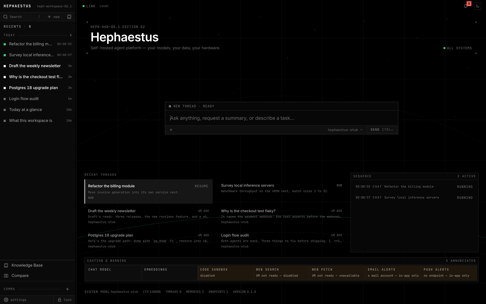

# Hephaestus

```
HEPH-HUD ── AGENT PLATFORM ─────────────────────────────────── ■ ALL SYSTEMS
  HOST      self-hosted · single operator · your hardware
  DATA      AES-256 at rest · key derived from your password, held in memory
  AGENTS    define · delegate · message · open any sub-agent as a thread
  EXTEND    plugins · skills · routines · workflows
  CONTEXT   searched on demand · never injected
  MODELS    any OpenAI-compatible, Anthropic or Google endpoint
────────────────────────────────────────────────────────────────────────────
```

Hephaestus is a self-hosted agent platform. You hand it work; agents plan it, split it between them, carry it out, and write the tools they are missing along the way. One agent stays in charge of each conversation and answers to you. Nothing an agent builds for itself (a new agent, a plugin, a skill, a routine) goes live until you approve it.



<sub>Captured on the disposable dev instance with a scripted model. The amber cells are real: that instance runs without the platform VM.</sub>

It is built for **one operator on one powerful machine**, and it assumes models capable of native tool calling.

## What it does

### Agents that work together

- **One chat, every capability.** There are no modes. Every message runs the full agent loop over the whole tool catalog your permission level allows: files, a shell, web search, memory, email, calendar, and the rest. The tools a chat doesn't need yet stay out of its context until it searches for them.
- **Agents you define.** An agent is a standing brief plus limits: its model, the tools it may use, how far it may reach without asking, and whether it may delegate. Write them yourself, drop them into a project's `.claude/agents/`, or let an agent draft one for you to publish. Start any chat with any agent.
- **Delegation trees.** An agent can spawn others to do self-contained work in parallel, to any depth you allow. Spawning never blocks: reports arrive on their own and wake the thread that asked. Agents in one tree can message each other, so one can point a sibling at the gap it found.
- **Every sub-agent is a thread.** Open any sub-agent as its own conversation, read what it did, and talk to it directly while its report still goes to its parent.
- **Per-endpoint queueing.** Each model endpoint has a capacity. Runs past it wait their turn, your own messages first, and a parent can never deadlock against a child waiting on the same endpoint.

### A platform that extends itself

- **Plugins.** Agents write tools in Python, test them in the platform VM, and hand them to you. Once you publish one, its tools join the catalog. A plugin declares the only hosts it can reach and the secrets it needs. Its code never sees a secret's value: the egress gateway swaps it in, and only toward that secret's own host.
- **Skills.** Know-how that loads on demand instead of living in the system prompt. Four ship with the app (`research`, `delegation`, `build-an-agent`, `build-a-plugin`). A project's `.claude/skills/` join them, and you or the agent can save more. The prompt names only the built-in four; the rest are found by search.
- **Routines.** Scheduled or webhook-triggered work, run by the agent you choose, on time. Each run opens a thread of its own, runs in slots reserved for routines, and never waits behind your chats. Type a schedule as a phrase ("every weekday at 9"). Agents can draft routines for you to approve, and plugins can offer them as templates.
- **Workflows.** Slash commands you write once and reuse in any chat.

### Context on demand

A conversation's context holds only that conversation. Everything else is searched when it's needed rather than injected up front, so the context doesn't grow with your history:

- **`platform_search`** reaches other conversations, memory, your indexed files, work summaries, sub-agent reports, routine outputs, and the skill, agent and plugin catalogs. Its index is built in memory at unlock, so nothing is stored in plaintext on disk.
- **Memory.** Durable facts the agent keeps unprompted (preferences, projects, people, constraints), and you can view, edit and delete them.
- **Knowledge Base.** Point it at folders of your documents and retrieve from them by meaning.
- **Compaction.** When a thread nears its model's context window, its earlier turns fold into a summary and the chat carries on. The transcript keeps everything.

### Where the work happens

- **Projects.** A chat filed under a project works directly in that folder, on the branch you have checked out, with writes governed by your permission level. When the work should stay apart, the agent moves the chat onto its own git worktree, which reaches your folder only through a merge you press.
- **The platform VM.** One microVM runs the code sandbox, the project shell, headless Chromium and a managed SearXNG. No host directory is mounted into it: files are piped in for the task at hand and piped back out, and its only network exit is an allowlisting gateway on the host.
- **The View.** One surface where the agent shows its output, a file or a live server, as snapshots you can star and come back to.
- **Compare.** One prompt sent to two models side by side, each pane a real, resumable conversation.

### Reach

- **Web search and fetch** through the VM's SearXNG and browser, with SSRF guards on every request. Fetched content is marked as untrusted data before it reaches a prompt.
- **Email** over IMAP/SMTP, Gmail, Microsoft Graph or JMAP, with AI triage and drafts that match how you write.
- **Calendar**: local-first, with CalDAV sync, `.ics` import and export, recurrence, and natural-language entry.
- **MCP servers** and **preset integrations**, sensitive by default until you trust them.
- **Notifications** for approvals, failures, completions and reminders. The two worth interrupting you for also go out by email and push.

### Your controls

- **Permission levels**, from plan-only to fully autonomous, decide what the agent may do without asking. Anything that leaves the box (your host, your real files, email, the vault, a new domain) pauses for your approval.
- **Model registry.** Named roles map to ordered fallback chains across OpenAI-compatible, Anthropic and Google endpoints, and each agent can run on its own.
- **Vault, API tokens, backup.** A password manager the agent can reach only with approval, scoped tokens and inbound webhooks, and encrypted backup and restore.
- **Offline mode**, manual or auto-detected. Web capabilities suspend themselves and say so.

## How it's built

**Pydantic AI is the engine, and the code around it is the chassis.** The model call, tool selection, argument validation, the tool loop, retries and fallback all run through Pydantic AI. Everything that turns a model run into a durable product is the chassis: run lifecycle, the event stream, surviving a disconnect, resume, cancellation, lanes and queues, persistence, access policy, and the verifier.

The central abstraction is the **Run**: one server-side, background unit of work. Chat turns, sub-agent turns, routine runs and wakes are all Runs, so continuity, cancellation, timeouts and metrics are written once. The backend is an origin-agnostic API, and **all logic lives there**; the frontend renders and captures intent.

```
frontend/   SolidStart SPA · TypeScript · Tailwind v4 · Vite
backend/    Pydantic AI + FastAPI (Python 3.14, uv)
  agent/      the engine: orchestrator, event translation, meta-loop, compaction
  runs/       the Run substrate, lanes, endpoint queues, the v1 event protocol
  tools/      the agent's tool catalog and its gates
  services/   capabilities: agents, plugins, skills, routines, vm, corpus, mail, …
  harness/    feature manifests and start/stop lifecycle
  skills/     the built-in skills
  vm/         the platform VM's image and guest agent
docs/       architecture, the decision register, the design system
```

The full design is in [`docs/architecture/`](docs/architecture/README.md). Every decision with real trade-offs is in [`docs/architecture/decisions.md`](docs/architecture/decisions.md), with the alternatives that were rejected. The visual language is in [`docs/design-system.md`](docs/design-system.md).

## Running it

**Backend** (needs [uv](https://docs.astral.sh/uv/)):

```bash
cd backend
uv sync                 # Python 3.14 virtualenv and dependencies
uv run python dev.py    # http://localhost:8000, with auto-reload
uv run pytest           # the test suite
uv run ruff check .     # lint
```

**Frontend** (needs [bun](https://bun.sh)):

```bash
cd frontend
bun install
bun run dev             # http://localhost:5173
bun run typecheck && bun run lint && bun run test
```

On first launch, create the operator account in the browser. The password you choose also derives the encryption key.

The platform VM needs [QEMU](https://www.qemu.org). With KVM on Linux or Hypervisor.framework on macOS it is fast; without either it still runs, slowly. Its first boot builds the guest image once, which takes several minutes and needs internet access. Without the VM, the sandbox, project shell, web search and fetch report themselves unavailable; nothing falls back to the host.

You point Hephaestus at model endpoints you already run (LM Studio, vLLM, llama.cpp) or at a hosted provider. It does not download or serve models itself.

**A disposable instance for development.** A second Hephaestus with its own data, ports and VM, a scripted model behind it, seeded on first use and safe to break:

```bash
cd backend
uv run python dev_instance.py up --detach     # start everything, print the URLs
uv run python dev_instance.py status --json   # ports differ per git worktree
uv run python dev_instance.py reset --yes     # wipe it; the next `up` re-seeds
```

The full recipe, including scripting the model's replies, is in [`docs/dev-instance.md`](docs/dev-instance.md).

> **Running `alembic` by hand:** the CLI falls back to `alembic.ini`, which points at the live `data/app.db`. Set `HEPHAESTUS_DB_URL` to aim it anywhere else.

## Security and privacy

Hephaestus runs code, writes files and sends email on your behalf, so its security model is designed rather than bolted on. The details are in [SECURITY.md](SECURITY.md).

- **One operator.** Every request is authenticated before it reaches a feature, and every record carries its owner.
- **A blast radius, not a cage.** Agent workspaces are disposable, either a copy in the VM or a git worktree on a throwaway branch, so computing and installing cost nothing. What is guarded is the way out.
- **The exits ask first.** Changing your host, writing your real files, sending mail, touching the vault or reaching a domain the allowlist doesn't name all pause for approval.
- **What agents build waits for you.** New agents, plugins, skills and routines are drafts until you publish them, and changing a published one asks again.
- **Encrypted at rest.** All user data is AES-256 encrypted under a key derived from your password that lives only in memory and is gone on restart.
- **Untrusted content is data.** Web pages, files, tool output and other agents' reports are fenced so the model treats them as material, not instructions.
- **Local-first.** Nothing leaves your machine unless you configure a provider or integration that sends it.

Serve plain HTTP only on `localhost` or a trusted LAN. Put a TLS-terminating reverse proxy in front of anything reachable beyond that.

All user data lives under `data/`, which is gitignored. Never commit anything from `data/`, `.env` or `logs/`.

## What's left

- **Routine depth:** chaining one routine into another, and event triggers beyond the inbound webhook.
- **The health screen** still renders fixtures. Real capability health is on the home page.

## Contributing

Help is welcome. The two sources of truth are the [architecture and its decision register](docs/architecture/README.md) and the capabilities of FastAPI and Pydantic AI. Requirement ids (`XC-*`, `AE-*`, `DR-*`) still appear in docstrings from the spec this rebuild started from. They are historical; where one disagrees with the code, the code is right.

A decision with real trade-offs belongs in `docs/architecture/decisions.md`, along with the angles that were rejected.

## Lineage

Hephaestus began as **Odysseus**, a rebuild of PewDiePie's original self-hosted workspace on Pydantic AI and FastAPI. It outgrew the name once it became a platform for agents rather than a workspace for one assistant. See [ACKNOWLEDGMENTS.md](ACKNOWLEDGMENTS.md).

## License

MIT. See [LICENSE](LICENSE).

```
SYSTEM  HEPHAESTUS · MIT · SELF-HOSTED ─────────────────────────────── ■ READY
```
